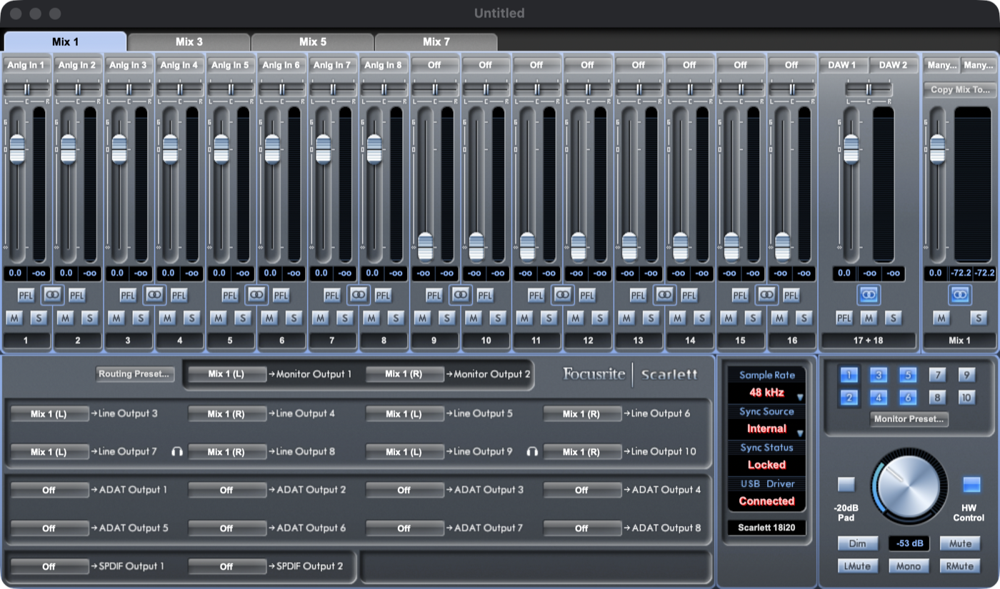
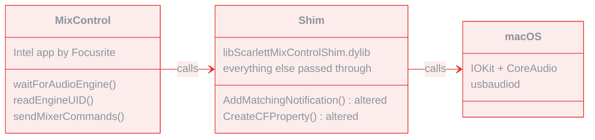
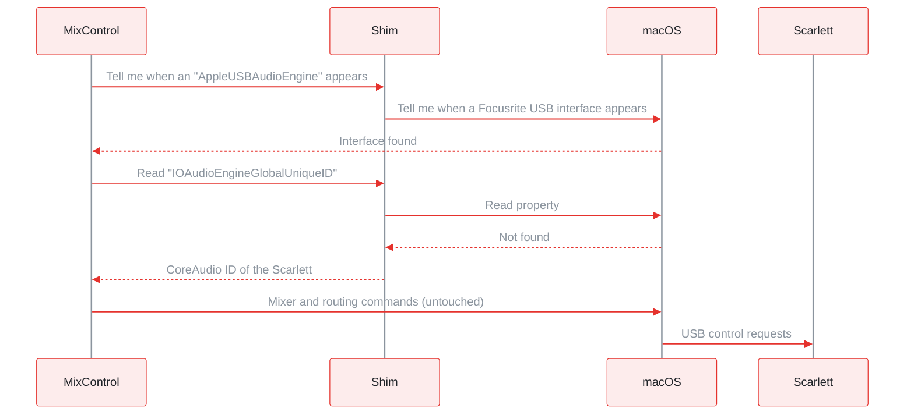

# scarlett-gen1-macos-fix

An unofficial fix that makes Focusrite's **Scarlett MixControl** work again with **1st-gen Scarlett** interfaces on current macOS, including Apple Silicon.

On current macOS, MixControl shows "NO HARDWARE CONNECTED" even when the interface is plugged in and working. This project patches a copy of the app so it finds the device. The original app isn't modified.

| Before | After |
|---|---|
|  |  |

## Devices

Scarlett **18i20** (tested), **18i8**, **18i6**, **8i6**, **6i6** (1st gen, untested).

## Tested on

| | |
|---|---|
| Mac | MacBook Pro, Apple M1 Max |
| macOS | 27.0.1 |
| Interface | Scarlett 18i20 (1st gen) |
| MixControl | 1.10.6 (running under Rosetta 2) |

Other setups probably work. Please open an issue to report yours.

## Requirements

- Scarlett MixControl 1.10.6 installed in `/Applications`
- Rosetta 2 on Apple Silicon: `softwareupdate --install-rosetta --agree-to-license`
- Command Line Tools: `xcode-select --install`

## Install

1. Download **Scarlett MixControl 1.10.6** for Mac from [Focusrite](https://downloads.focusrite.com/focusrite/scarlett-1st-gen/scarlett-18i20-1st-gen).
2. Open the downloaded `.dmg` and drag **Scarlett MixControl** into **Applications**.
3. Run:
   ```sh
   git clone https://github.com/jcksnvllxr80/scarlett-gen1-macos-fix.git
   cd scarlett-gen1-macos-fix
   ./build.sh --install
   ```

## Launch

Open **Scarlett MixControl (Patched)** from Applications. The original app won't connect.

## Warnings

- Don't use MixControl's firmware update with the patched app.
- MixControl may overwrite the mixer settings stored on the device. Save a snapshot first if they matter.

## Troubleshooting

- Quit MixControl, replug the interface, and open the app again.
- Log: `~/Library/Logs/ScarlettMixControlShim.log`. For a detailed log, run: `open --env SCARLETT_SHIM_DEBUG=1 "/Applications/Scarlett MixControl (Patched).app"`

## How the sausage is made 🌭

A **shim** is a thin layer between two programs. Each side thinks it's talking directly to the other. The shim passes most messages through unchanged and alters a few.

### Where the shim sits



### What happens at startup



### How it gets in

1. `build.sh` puts the shim inside a copy of the app.
2. The copy's launcher sets `DYLD_INSERT_LIBRARIES`.
3. macOS's program loader (`dyld`) loads the shim before MixControl starts.
4. The shim routes two system functions through itself.
5. MixControl's code is never modified. Only the answers it gets back change.

### How MixControl ends up calling the shim

- Focusrite's code calls macOS functions through a linking table that `dyld` fills in at launch.
- The shim tells `dyld` to put its own address in that table for two of Apple's functions.
- So MixControl calls the shim, and the shim calls Apple's real functions and adjusts the result when needed.

### Why it's safe

- It only affects Focusrite devices (USB vendor ID `0x1235`).
- It only changes how the device is found. Mixer commands go through untouched.
- It only runs inside the patched copy, not anywhere else on your Mac.

Full details are in [`shim.c`](shim.c).

## License

[MIT](LICENSE). Provided as-is, without warranty. Not affiliated with Focusrite. Focusrite, Scarlett and MixControl are trademarks of Focusrite Audio Engineering Ltd.
